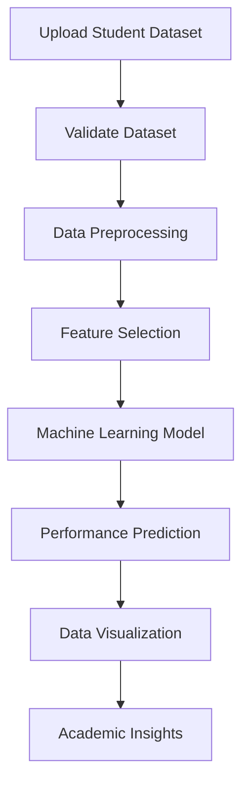

# Student_Performance_Prediction_System_Mini_Project

## 📌 About the Project

The **Student Performance Prediction System** is a web-based mini project developed to analyze student academic performance and predict future academic outcomes using Machine Learning and Data Mining techniques.

The system helps teachers understand student performance through academic data such as attendance, previous scores, assignment marks, study hours, and other relevant attributes.

Users can upload their own dataset, analyze student records, generate predictions, and visualize academic performance through interactive graphs and dashboards.

The project aims to support data-driven academic decision-making and help identify students who may require additional academic support.

## 🎯 Project Objectives

- Analyze student academic performance using uploaded datasets.
- Predict student performance using Machine Learning techniques.
- Identify students who may be at academic risk.
- Provide meaningful academic insights through graphs and charts.
- Support teachers in monitoring student progress.
- Provide students with personalized performance insights.
- Perform predictions using the uploaded dataset rather than relying on predefined sample records.

## ✨ Key Features

### 📊 Student Performance Analysis
- Analyze academic performance based on available dataset attributes.
- Display student academic information.
- Identify performance patterns and trends.
- Generate statistical summaries.

### 🤖 Machine Learning Prediction
- Predict student academic performance.
- Support classification or regression based on the dataset target.
- Identify potential academic performance levels.
- Evaluate model performance using appropriate metrics.

### 📁 Dataset Upload
- Upload student datasets in CSV or Excel format, depending on application support.
- Analyze the uploaded dataset.
- Validate dataset columns and data types.
- Handle missing and inconsistent values.
- Use uploaded data for analysis and prediction.

### 📈 Interactive Data Visualization
- Student performance distribution.
- Attendance analysis.
- Academic score comparison.
- Study hours and performance relationships.
- Performance prediction charts.
- Dataset-based analytical graphs.

### 👨‍🏫 Teacher Dashboard
- View student academic records.
- Analyze student performance.
- Upload and manage datasets.
- Generate performance predictions.
- Identify students requiring academic support.

### 👨‍🎓 Student Dashboard
- Access individual academic information.
- View performance analysis.
- Check prediction results.
- Understand academic strengths and weaknesses.
- Monitor performance based on available records.

### 🔐 Authentication and Role-Based Access
- Separate teacher and student access.
- Role-based navigation.
- Secure login and registration.
- Student identification using available student records.
- Access to relevant features based on user role.

### 🎨 Modern User Interface
- Responsive web application.
- Clean and user-friendly dashboard.
- Light and dark theme support, if enabled.
- Interactive navigation.
- Organized academic analytics.

---

## 🛠️ Technology Stack

The project uses web development, data analysis, and machine learning technologies.

| Category | Technology |
|---|---|
| Frontend | HTML, CSS, JavaScript / React |
| Backend | Python / Node.js, depending on implementation |
| Machine Learning | Scikit-learn |
| Data Analysis | Pandas, NumPy |
| Visualization | Matplotlib / Plotly / Chart.js |
| Dataset | CSV / Excel |
| Development Tools | VS Code, Git, GitHub |

*The exact technologies depend on the implementation available in the repository.*

---

## 🧠 Machine Learning Approach

The system follows a machine learning workflow to analyze student academic records.

### Workflow

1. Upload the student dataset.
2. Validate the dataset structure.
3. Identify relevant academic attributes.
4. Clean and preprocess the data.
5. Handle missing values and inconsistent records.
6. Select appropriate features and target variables.
7. Train or load the suitable machine learning model.
8. Generate student performance predictions.
9. Evaluate the model.
10. Display prediction results and analytical visualizations.

### Supported Machine Learning Algorithms

Depending on the dataset and prediction objective, the project may use:

- Linear Regression
- Logistic Regression
- Decision Tree
- Random Forest
- Other suitable Scikit-learn algorithms

The model should be selected according to the dataset structure and whether the target represents a numerical score or a performance category.

---

## 📂 Dataset Requirements

The system is designed to work with student academic datasets uploaded by the user.

Example dataset attributes:

| Attribute | Description |
|---|---|
| Student ID | Unique student identifier |
| Name | Student name |
| Attendance | Student attendance percentage |
| Past Score | Previous academic score |
| Assignment | Assignment marks |
| Study Hours | Weekly study hours |
| Backlogs | Number of pending subjects |
| Target Score | Academic target or prediction target |

### Dataset Example

```csv
Student ID,Name,Attendance,Past Score,Assignment,Study Hrs/Wk,Backlogs,Target Score
101,Student A,85,78,80,12,0,82
102,Student B,65,55,60,6,2,58
103,Student C,92,88,90,18,0,91
104,Student D,75,68,72,10,1,70
```

**Note:** The above records are illustrative examples for understanding the dataset format. Actual predictions and analysis should be performed using the dataset uploaded by the user.

### Dataset Validation

The application should:

- Check whether required columns are available.
- Validate numerical attributes.
- Detect missing values.
- Identify duplicate records.
- Handle invalid values.
- Verify that the target column is suitable for prediction.
- Display understandable validation errors.

---

## 📈 Model Evaluation

The model should be evaluated using appropriate metrics based on the prediction task.

### Classification

For predicting categories such as Pass/Fail or Low/Medium/High:

- Accuracy
- Precision
- Recall
- F1-score
- Confusion Matrix

### Regression

For predicting numerical academic scores:

- Mean Absolute Error (MAE)
- Mean Squared Error (MSE)
- Root Mean Squared Error (RMSE)
- R² Score

Evaluation results should be calculated from actual model predictions and test data.

---

## 🔄 Project Workflow



---

## 👥 User Roles

### Teacher

Teachers can:

- Access the teacher dashboard.
- Upload student datasets.
- View student academic records.
- Analyze academic performance.
- Generate predictions.
- View performance charts.
- Identify students who may need support.

### Student

Students can:

- Access their student dashboard.
- View their academic records.
- Check their performance analysis.
- View prediction results.
- Understand their academic progress.

Student access should be restricted to the appropriate student record when the application uses authenticated student identification.

---

## 🚀 Installation and Setup

### 1. Clone the Repository

```bash
git clone https://github.com/ansukhan164-rgb/Student_Performance_Prediction_System_Mini_Project.git
```

### 2. Navigate to the Project Directory

```bash
cd Student_Performance_Prediction_System_Mini_Project
```

### 3. Install Dependencies

For a Python-based implementation:

```bash
pip install -r requirements.txt
```

For a Node.js-based frontend:

```bash
npm install
```

### 4. Configure Environment Variables

Create a `.env` file if required by the application.

Add the environment variables required by your project configuration.

**Important:** Do not upload passwords, API keys, database credentials, or other sensitive information to GitHub.

### 5. Run the Application

For a Python application:

```bash
python app.py
```

For a Node.js application:

```bash
npm run dev
```

Use the actual application entry point and available scripts from the repository.

### 6. Open the Application

Open the local URL displayed in the terminal after the application starts.

---

## 📊 Expected Output

The application is intended to provide:

- Student academic performance analysis.
- Dataset-based performance predictions.
- Academic performance charts.
- Attendance and score analysis.
- Student performance comparisons.
- Prediction results based on uploaded records.
- Insights that support academic improvement.

Actual outputs depend on the uploaded dataset, available features, and trained machine learning model.

---

## 🔒 Data Privacy

Student academic information may contain sensitive personal data.

The project should follow these practices:

- Use authorized datasets.
- Avoid uploading confidential student information to public repositories.
- Do not expose student passwords or authentication details.
- Restrict student access to their own records.
- Validate uploaded files before processing.
- Avoid storing unnecessary personal information.

For public demonstrations, use anonymized or appropriately authorized datasets.

---

## 🎓 Academic Information

| Detail | Information |
|---|---|
| Project Title | Student Performance Prediction System |
| Project Type | Mini Project |
| Domain | Data Mining and Machine Learning |
| Application | Web-Based Student Analytics |
| Purpose | Student Academic Performance Analysis and Prediction |
| Developer | Ansar Khan |
| GitHub | [ansukhan164-rgb](https://github.com/ansukhan164-rgb) |

---

## 🔮 Future Enhancements

- Improve prediction accuracy using additional real academic datasets.
- Add advanced machine learning algorithms.
- Introduce personalized academic recommendations.
- Implement automated student performance reports.
- Add downloadable analytical reports.
- Improve dataset validation and preprocessing.
- Introduce additional academic performance indicators.
- Enhance dashboard analytics.
- Support larger datasets and multiple academic institutions.

---

## 🤝 Contributing

Contributions, suggestions, and improvements are welcome.

1. Fork the repository.
2. Create a new branch.
3. Make your changes.
4. Test the application.
5. Submit a pull request.

---

## 📜 License

This project is developed for educational and academic purposes.

Add a suitable open-source license to the repository if you intend to distribute the project for reuse.

---

## 👨‍💻 Author

**Ansarul Khan**

GitHub: [@ansukhan164-rgb](https://github.com/ansukhan164-rgb)

Project Repository:

[Student Performance Prediction System Mini Project](https://github.com/ansukhan164-rgb/Student_Performance_Prediction_System_Mini_Project)

---

<p align="center">

⭐ If you find this project useful, consider giving the repository a star!

</p>

**Made with ❤️ for Student Performance Analysis and Machine Learning**

